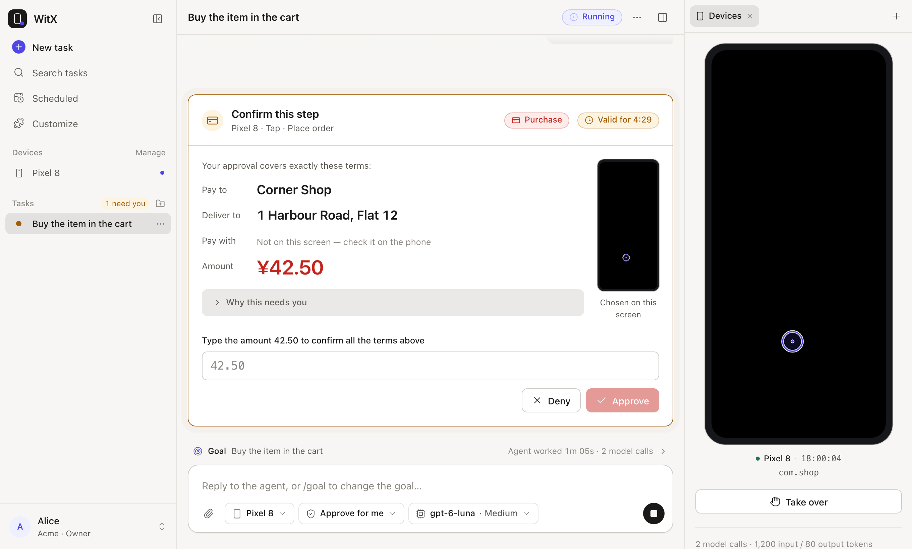
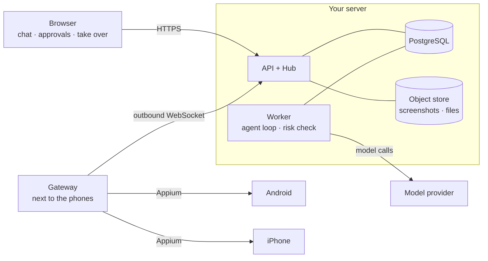

# WitX

**Tell an agent what to do on your phone — and stay in charge of every step that matters.**

English | [简体中文](README.zh-CN.md)

[](LICENSE)


WitX is a self-hosted agent that operates your own Android and iOS phones — real devices or emulators — from a chat in your browser. You describe a goal; the agent looks at screenshots, plans, and taps, types and swipes through a small Gateway running next to the phones. Anything sensitive — paying, deleting, sharing personal data — stops and waits for you, showing the exact terms you are approving.

<picture>
  <source media="(prefers-color-scheme: dark)" srcset="docs/images/task-approval-dark.png">
  
</picture>

<sub>The agent reached checkout and stopped. Your approval is bound to these exact terms: if the amount or recipient changes, it no longer counts.</sub>

## Why WitX

Most phone automation is either brittle scripts or an agent you have to trust blindly. WitX is built around a different deal:

- **It works on real apps.** No APIs or integrations needed: if you can do it by hand on the phone, the agent can try it.
- **You decide what needs you.** Choose a permission mode per task. Payments always wait for an explicit approval that is bound to the amount, recipient and screen.
- **Every input runs at most once.** If the outcome of a tap is unclear, the device stops until you look at a fresh screenshot and say what happened — the agent never "just retries" a payment.
- **You can grab the wheel.** Pause a task and take over the phone from your browser at any time. Stopping waits until the phone confirms it has stopped.
- **Your data stays on your machines.** One person, one deployment. Screenshots and task text go only to the model providers you configure.

## Features

| | |
| --- | --- |
| 📱 **Real phones** | Android (UiAutomator2) and iOS (XCUITest), physical devices or emulators/simulators. New devices are discovered automatically. |
| 🧠 **Conversational tasks** | Plain-language goals, follow-up messages while it works, `/goal` to change direction, `/plan` to review an approach before anything is changed. |
| 📲 **Several phones at once** | Sub-agents split a task across devices, e.g. compare prices on two phones. |
| ✅ **Approvals with exact terms** | Purchases show payee, address, amount and the screen they came from; you type the amount to confirm. |
| 🖐 **Take over** | Live screen and input in the browser, sharing the same device lock as the agent. |
| 🧩 **Skills & Plugins** | `/skill` turns a finished task into a reusable method you review and save. Text-only Plugins install from a marketplace after you read them. |
| ⏰ **Schedules** | Run a task at a local time, once or repeatedly. |
| 📎 **Files** | Attach files to a task; the agent can hand one to an iPhone through the WitX app. |
| 🔌 **MCP** | Other agents (e.g. Claude Code) can start and follow WitX tasks over MCP — approvals still stay with people. |
| 🌗 **Polished UI** | English & Simplified Chinese, light & dark, works on phone-sized screens. |

## Project status

WitX is a **developer preview**: it works end to end and every change runs through 1,000+ Python tests plus web unit and browser tests in Chromium and WebKit, but expect rough edges and breaking changes.

| Area | Status |
| --- | --- |
| Android phones & emulators | ✅ Supported |
| iPhone & iOS simulators | ✅ Supported (physical devices need WebDriverAgent signing and Developer Mode) |
| Gateway host | ✅ macOS, Linux · ⚠️ Windows not validated |
| Approvals, take over, UNKNOWN rulings, stop barrier | ✅ Supported, with behavior tests |
| Multi-phone tasks, schedules, memory, Skills & Plugins | ✅ Supported |
| Docker Compose deployment with OIDC + HTTPS | ✅ Supported |
| Sending files to the phone | 🧪 iPhone only, needs the WitX app built from `apps/ios` · ⏳ Android not yet |
| Prebuilt iPhone app / App Store | ⏳ Not available — build it with Xcode |
| Teams / multi-user collaboration | 🚫 Not a goal — WitX is for one person's own phones |

### Recent improvements (2026-11-02)

- **Files:** give a task up to 10 files (100 MiB each); the agent can deliver one to an iPhone, where the new thin WitX app downloads and checks it.
- **Clearer UNKNOWN handling:** when an input's effect is unknown, the run waits for your ruling once and receives it as the input's result.
- **Device housekeeping:** devices that are gone are set apart and can be removed; a Gateway that vanished without saying so is marked offline after 90 s; `witx admin force-stop` finishes a stop whose Gateway is gone for good.
- **Leaner model calls:** each call carries only the tools the run can use; the separate app search tool is gone.
- **UI:** time markers in the conversation, "N need you" jumps to waiting tasks, one search across Skills and Plugins, file limits shown before you pick.
- **Language:** the agent is told the language you write in.
- **Fixes:** the browser opens the address it was given; Android opens the app, not a system component; option searches stop on time.
- **Dev ports** moved to 47100 (API) and 47173 (web) to avoid clashing with common tools.

Full history: [CHANGELOG.md](CHANGELOG.md).

## How it works



1. The model proposes an input from the latest screenshot and says what it expects to happen.
2. A separate risk check and pure policy rules decide whether it may run or must wait for you.
3. The Gateway re-checks the device, screen and lease right before acting, records the intent in a local journal, and executes it once.
4. A new screenshot comes back. If the outcome can't be known, the device waits for your ruling.

The Gateway only connects outward, so phones never need open ports. More in [docs/architecture.md](docs/architecture.md) (Chinese).

## Quick start

You'll need **Python 3.12+, [uv](https://docs.astral.sh/uv/), Node.js 22+, pnpm 10.33, PostgreSQL 15+**, and an API key for a model with vision and tool calling. The steps below use a **fake phone** so you can check everything is wired up before connecting a real one.

> 🤖 **Prefer to let a coding agent do it?** Jump to [Set up with an agent](#set-up-with-an-agent).

**1. Install and configure**

```sh
git clone https://github.com/FoLAWy-py/WitX-Preview.git && cd WitX-Preview
make setup
cp .env.example .env                                   # set OPENAI_API_KEY and WITX_DEFAULT_MODEL
cp services/gateway/gateway.fake.toml gateway.toml
```

**2. Create the database** (local trust auth assumed; use real passwords anywhere else)

```sh
psql -d postgres -c "CREATE ROLE witx_owner LOGIN CREATEROLE" \
                 -c "CREATE ROLE witx_app_login LOGIN" \
                 -c "CREATE DATABASE witx OWNER witx_owner"
set -a; . ./.env; set +a
make db-migrate
psql "$WITX_ADMIN_DATABASE_URL" -c 'GRANT witx_app TO witx_app_login'
uv run witx admin add-user --tenant demo --subject alice --name Alice
uv run witx admin add-gateway --tenant demo --name test-host   # prints a one-time code
```

**3. Start the services** — one terminal each, running `set -a; . ./.env; set +a` first in the API and Worker terminals:

| Terminal | Command |
| --- | --- |
| API | `make dev-api` |
| Worker | `make dev-worker` |
| Web | `make dev-web` |
| Gateway | `uv run witx-gateway --config gateway.toml enroll` (paste the code, once), then `make dev-gateway GATEWAY_CONFIG=gateway.toml` |

**4. Open [http://127.0.0.1:47173](http://127.0.0.1:47173)**, sign in with `dev-token-alice`, and enable *Preview fake phone* on the Devices page. The fake phone just changes the color of a synthetic screen — it proves the loop works, not that apps do.

**5. Connect a real phone** using [gateway.example.toml](services/gateway/gateway.example.toml), then let the Gateway check and fix the host:

```sh
uv run witx-gateway --config gateway.toml doctor   # read-only checks
uv run witx-gateway --config gateway.toml setup    # proposes fixes, asks before each
```

Use a spare phone or test accounts at first: screenshots go to your model provider, and models make mistakes.

### Set up with an agent

Paste this into Claude Code, Codex or a similar coding agent opened in the repository:

```text
Set up WitX-Preview for local development on this machine and get it running with the fake phone.

Read README.md (Quick start), docs/development.md and AGENTS.md first, then:
1. Check the prerequisites: Python 3.12+, uv, Node.js 22+, pnpm 10.33, PostgreSQL 15+ running locally.
   If something is missing, tell me what and how you would install it, and wait for my OK.
2. Run `make setup`. Create .env from .env.example and gateway.toml from
   services/gateway/gateway.fake.toml. Ask me for the model API key and the model name
   (WITX_DEFAULT_MODEL); write them into .env yourself and never print the key back.
3. Create the PostgreSQL roles and database as in the Quick start (ask me first if my
   local PostgreSQL needs a password or different superuser), run `make db-migrate`,
   the GRANT, and add the user `alice` and a gateway `test-host` in tenant `demo`.
4. Start the API, Worker and Web dev servers as background processes with .env loaded,
   enroll the Gateway with the one-time code (pipe it on stdin), then start the Gateway.
   If ports 47100 or 47173 are taken, stop and tell me what is using them.
5. Verify: `curl -H "Authorization: Bearer dev-token-alice" http://127.0.0.1:47173/api/v1/devices`
   should list "Preview fake phone" with "online": true.
6. Tell me how to open the app and enable the device, how to stop everything, and where the logs are.

Rules: do not connect real phones, install system packages, or change anything outside this
repository and the local database without asking. Do not commit .env, gateway.toml or journals.
```

## Using WitX

Pick the phones, model and permission mode when you create a task, then describe the goal, its limits, and anything the agent should ask you first.

| Permission mode | What waits for you |
| --- | --- |
| **Ask first** | Anything that changes data; looking around runs. |
| **Approve for me** (default) | Payments, deletions, sharing personal data, account changes, inputs in sensitive apps, and anything the risk check could not assess. Messages and orders paid for in a later step go ahead. |
| **Full access** | Only payments and transfers. The Owner must enable this mode first. |

Handy commands in the message box: `/goal` (set, pause or clear the goal), `/plan` (plan first, approve before changes), `/skill` (draft a reusable Skill from this task), `/schedule`, `/constraints`, and `$name` to ask for a specific Skill. Optional Plugins come from the [Preview marketplace](https://github.com/FoLAWy-py/witx-plugins-preview):

```sh
uv run witx plugin install basics    # shows the full text and asks before installing
```

## Things to know

- **Check the results.** Models misread screens and miss requirements; pages change between screenshots. A completed task is not proof that every requirement was met.
- **Passwords, verification codes and payment verification are yours.** The agent can't type into system password fields, but ordinary code fields, custom controls and anything visible in a screenshot are not fully protected. Enter those yourself via take over.
- **Unknown outcomes need a fresh look.** Don't simply redo an operation whose result is unknown; resolve it from a newer screenshot.
- **Deleting a task doesn't delete everything.** Memories, Skills and backups have their own retention.
- **Compatibility varies** with phone OS versions, Appium drivers, signing and the apps themselves.

## Documentation

- [Development & deployment](docs/development.md) — real devices, iPhone app, Docker Compose, HTTPS, upgrades, backup & restore (Chinese)
- [Architecture](docs/architecture.md) — components, action lifecycle, safety and recovery (Chinese)
- [AGENTS.md](AGENTS.md) — engineering rules for contributors and coding agents
- `make check` runs lint, type checks, all tests and builds. Default tests use fake models and fake devices: no paid model calls, no real phones.

## Feedback

Issues and pull requests are welcome. Include reproduction steps, versions and the phone platform — and leave out keys, real device identifiers, accounts and screenshots with personal content. For security issues, please use GitHub's private vulnerability reporting.

## License

Original WitX code and documentation are licensed under the [Apache License 2.0](LICENSE); see [NOTICE](NOTICE). Third-party dependencies keep their own licenses, and web builds include [third-party notices](apps/web/public/THIRD_PARTY_NOTICES.txt). The license does not grant rights to the WitX name or logo. Contributions intentionally submitted for inclusion are provided under Apache-2.0.
