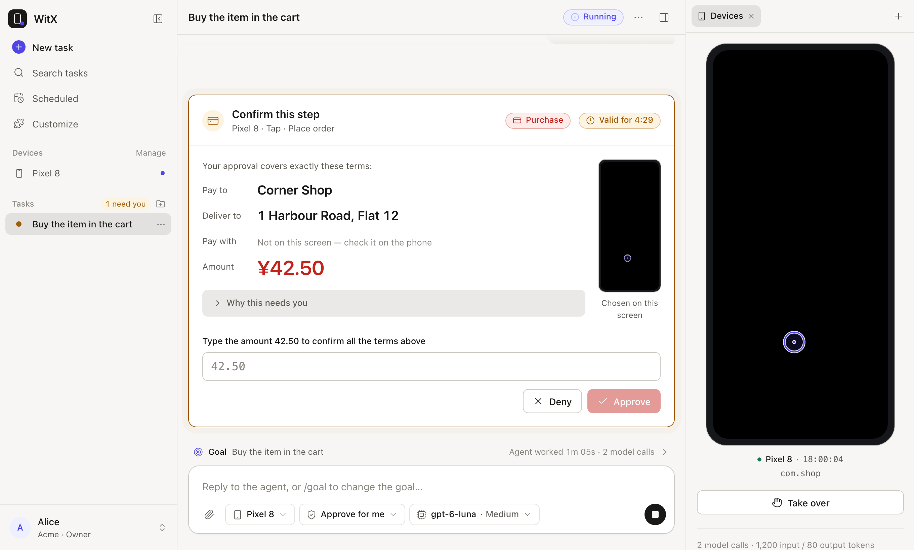
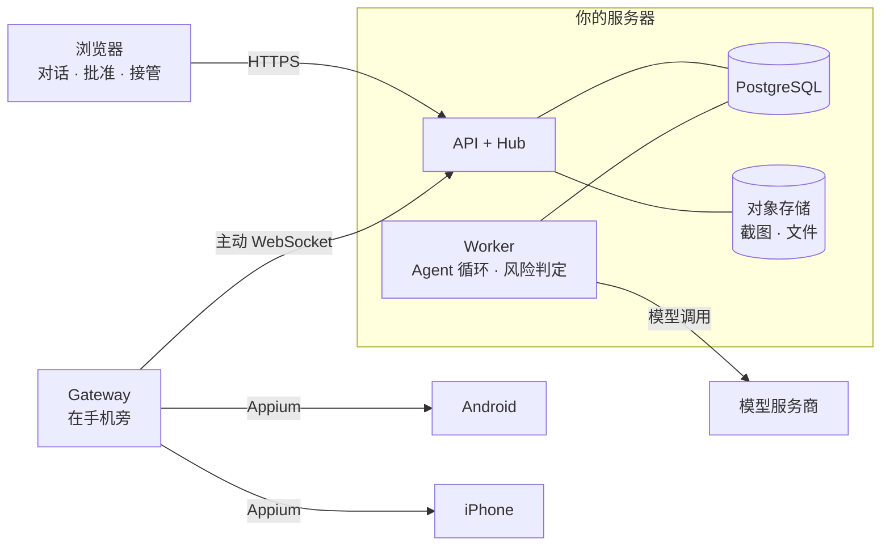

# WitX

**用一句话让 Agent 操作你的手机，重要的每一步仍由你决定。**

[English](README.md) | 简体中文

[](LICENSE)


WitX 是一个自部署的 Agent，在浏览器的对话里操作你自己的 Android 和 iOS 手机（真机或模拟器）。你说出目标，Agent 看截图、做计划，通过手机旁的 Gateway 点按、输入和滑动。付款、删除、分享个人信息这类敏感操作会停下来等你，并列出你批准的具体条款。

<picture>
  <source media="(prefers-color-scheme: dark)" srcset="docs/images/task-approval-dark.png">
  
</picture>

<sub>Agent 到了结账页就停下。你的批准绑定这些条款：金额或收款方一变，批准就不再有效。</sub>

## 为什么是 WitX

手机自动化通常不是脆弱的脚本，就是一个只能盲目信任的 Agent。WitX 的约定不一样：

- **直接用真实 App。** 不需要 API 或集成：你能在手机上手动做的事，Agent 就可以尝试。
- **由你决定什么需要你。** 每个任务选择权限模式。付款总要你明确批准，批准绑定金额、收款方和画面。
- **每个输入最多执行一次。** 一次点击的结果不确定时，这台设备会停下，直到你看过新截图并裁定发生了什么。Agent 不会“再试一次”付款。
- **随时接管。** 暂停任务，在浏览器里直接操作手机。停止要等手机确认已经停下才算完成。
- **数据留在你的机器上。** 一个人、一个部署。截图和任务文字只发给你配置的模型服务商。

## 功能

| | |
| --- | --- |
| 📱 **真实手机** | Android（UiAutomator2）和 iOS（XCUITest），真机或模拟器；自动发现新设备。 |
| 🧠 **对话式任务** | 用自然语言描述目标，执行中可以继续发消息；`/goal` 改目标，`/plan` 先看方案再决定是否修改。 |
| 📲 **多台手机协作** | 子 Agent 把任务分到几台设备上，例如在两台手机上比价。 |
| ✅ **按条款批准** | 购买时列出收款方、地址、金额和来源画面，输入金额才能确认。 |
| 🖐 **人工接管** | 浏览器里看实时画面、直接输入，与 Agent 共用同一把设备锁。 |
| 🧩 **Skill 与 Plugin** | `/skill` 把完成的任务整理成可复用的方法，由你检查后保存。纯文本 Plugin 从 marketplace 安装，安装前先读全文。 |
| ⏰ **定时任务** | 在本地时间运行一次或重复运行。 |
| 📎 **文件** | 给任务附文件；Agent 可以通过 WitX App 把文件交给 iPhone。 |
| 🔌 **MCP** | 其他 Agent（如 Claude Code）可以通过 MCP 创建和跟进 WitX 任务，批准仍然只能由人做出。 |
| 🌗 **界面** | 英文和简体中文，浅色和深色，适配手机屏幕。 |

## 项目状态

WitX 目前是**开发者预览版**：可以端到端运行，每次改动都要通过 1000 多个 Python 测试，以及在 Chromium 和 WebKit 上运行的 Web 单元测试和浏览器测试。但仍会有粗糙之处和不兼容的变更。

| 方面 | 状态 |
| --- | --- |
| Android 手机与模拟器 | ✅ 支持 |
| iPhone 与 iOS 模拟器 | ✅ 支持（真机需要 WebDriverAgent 签名和开发者模式） |
| Gateway 宿主机 | ✅ macOS、Linux · ⚠️ Windows 未验证 |
| 批准、接管、UNKNOWN 裁定、停止屏障 | ✅ 支持，有行为测试 |
| 多手机任务、定时、记忆、Skill 与 Plugin | ✅ 支持 |
| Docker Compose 部署（OIDC + HTTPS） | ✅ 支持 |
| 把文件交给手机 | 🧪 仅 iPhone，需自行用 `apps/ios` 构建 WitX App · ⏳ Android 暂不支持 |
| 预构建 iPhone App / App Store | ⏳ 暂无，需要用 Xcode 自行构建 |
| 团队 / 多人协作 | 🚫 不在目标内：WitX 面向个人使用自己的手机 |

### 最近改进（2026-11-02）

- **文件：** 每条消息最多附 10 个文件（单个 100 MiB）；Agent 可以把文件交给 iPhone，由新的轻量 WitX App 下载并校验。
- **更清楚的 UNKNOWN 处理：** 输入效果未知时，Run 只等你裁定一次，裁定就是这个输入的结果。
- **设备管理：** 不再连接的设备单独列出，可以移除；没有正常断开的 Gateway 在 90 秒后标为离线；`witx admin force-stop` 能完成 Gateway 永久离线的任务停止。
- **更精简的模型调用：** 每次调用只带这个 Run 能用的工具；单独的 App 搜索工具已移除。
- **界面：** 对话中显示时间，左栏“N 个待处理”直达等待中的任务，Skill 和 Plugin 共用一个搜索框，选文件前先说明限制。
- **语言：** Agent 会被告知你书写使用的语言。
- **修复：** 浏览器打开给定的网址；Android 打开 App 本身而不是系统组件；选项搜索按时停止。
- **开发端口** 改为 47100（API）和 47173（Web），避开常用工具。

完整历史见 [CHANGELOG.md](CHANGELOG.md)。

## 工作方式



1. 模型根据最新截图提出一个输入，并说明预期效果。
2. 独立的风险判定和纯函数策略规则决定它可以执行，还是要等你批准。
3. Gateway 在执行前再次核对设备、画面和租约，把意图写入本地 journal，只执行一次。
4. 新截图传回。结果无法确定时，设备等你裁定。

Gateway 只向外连接，手机不需要开放端口。详见 [docs/architecture.md](docs/architecture.md)。

## 快速开始

需要 **Python 3.12+、[uv](https://docs.astral.sh/uv/)、Node.js 22+、pnpm 10.33、PostgreSQL 15+**，以及一个支持视觉和工具调用的模型 API key。下面的步骤先用**假手机**确认链路正常，再接真机。

> 🤖 **想让编程 Agent 代劳？** 跳到[用 Agent 完成设置](#用-agent-完成设置)。

**1. 安装与配置**

```sh
git clone https://github.com/FoLAWy-py/WitX-Preview.git && cd WitX-Preview
make setup
cp .env.example .env                                   # 填写 OPENAI_API_KEY 和 WITX_DEFAULT_MODEL
cp services/gateway/gateway.fake.toml gateway.toml
```

**2. 创建数据库**（假设本机使用 trust 认证；其他环境请设置强密码）

```sh
psql -d postgres -c "CREATE ROLE witx_owner LOGIN CREATEROLE" \
                 -c "CREATE ROLE witx_app_login LOGIN" \
                 -c "CREATE DATABASE witx OWNER witx_owner"
set -a; . ./.env; set +a
make db-migrate
psql "$WITX_ADMIN_DATABASE_URL" -c 'GRANT witx_app TO witx_app_login'
uv run witx admin add-user --tenant demo --subject alice --name Alice
uv run witx admin add-gateway --tenant demo --name test-host   # 打印一次性注册码
```

**3. 启动服务**：每个服务一个终端，API 和 Worker 终端先运行 `set -a; . ./.env; set +a`。

| 终端 | 命令 |
| --- | --- |
| API | `make dev-api` |
| Worker | `make dev-worker` |
| Web | `make dev-web` |
| Gateway | `uv run witx-gateway --config gateway.toml enroll`（粘贴注册码，只需一次），然后 `make dev-gateway GATEWAY_CONFIG=gateway.toml` |

**4. 打开 [http://127.0.0.1:47173](http://127.0.0.1:47173)**，用 `dev-token-alice` 登录，在设备页启用 *Preview fake phone*。假手机只会改变合成画面的颜色，用来证明链路可用，不模拟真实 App。

**5. 接入真机**：参考 [gateway.example.toml](services/gateway/gateway.example.toml)，再让 Gateway 检查并修复宿主机：

```sh
uv run witx-gateway --config gateway.toml doctor   # 只检查
uv run witx-gateway --config gateway.toml setup    # 列出修复步骤，逐项确认后执行
```

一开始请用备用手机或测试账号：截图会发给模型服务商，模型也会出错。

### 用 Agent 完成设置

在仓库目录打开 Claude Code、Codex 或类似的编程 Agent，粘贴：

```text
在这台机器上为本地开发设置 WitX-Preview，并用假手机跑起来。

先读 README.md（Quick start）、docs/development.md 和 AGENTS.md，然后：
1. 检查前置条件：Python 3.12+、uv、Node.js 22+、pnpm 10.33、本机运行的 PostgreSQL 15+。
   缺什么就告诉我缺什么、打算怎么装，等我同意。
2. 运行 `make setup`。用 .env.example 生成 .env，用 services/gateway/gateway.fake.toml
   生成 gateway.toml。向我要模型 API key 和模型名（WITX_DEFAULT_MODEL），由你写进 .env，
   不要把 key 打印出来。
3. 按 Quick start 创建 PostgreSQL 角色和数据库（如果本机 PostgreSQL 需要密码或不同的超级用户，
   先问我），运行 `make db-migrate` 和 GRANT，在租户 `demo` 下添加用户 `alice` 和 gateway `test-host`。
4. 加载 .env 后，在后台启动 API、Worker 和 Web 开发服务；用一次性注册码（从 stdin 传入）注册
   Gateway，再启动 Gateway。如果 47100 或 47173 端口被占用，停下来告诉我是什么占用了它。
5. 验证：`curl -H "Authorization: Bearer dev-token-alice" http://127.0.0.1:47173/api/v1/devices`
   应列出 "Preview fake phone"，且 "online": true。
6. 告诉我怎样打开应用并启用设备、怎样停止所有服务、日志在哪里。

规则：未经我同意，不要连接真机、不要安装系统软件、不要修改本仓库和本地数据库以外的任何东西。
不要提交 .env、gateway.toml 或 journal。
```

## 使用 WitX

创建任务时选择手机、模型和权限模式，然后说明目标、范围，以及需要先问你的事情。

| 权限模式 | 哪些操作等你 |
| --- | --- |
| **先问我** | 任何修改数据的操作；查看和浏览直接进行。 |
| **替我批准**（默认） | 付款、删除、分享个人信息、修改账户、敏感 App 中的输入，以及风险判定无法评估的操作。发消息和稍后才付款的下单直接进行。 |
| **完全访问** | 只有付款和转账。需要 Owner 先启用。 |

输入框常用命令：`/goal`（设置、暂停或清除目标）、`/plan`（先做计划，批准后才修改）、`/skill`（把这个任务起草成 Skill）、`/schedule`、`/constraints`，用 `$名字` 点名一个 Skill。可选 Plugin 来自 [Preview marketplace](https://github.com/FoLAWy-py/witx-plugins-preview)：

```sh
uv run witx plugin install basics    # 先展示全文，确认后才安装
```

## 使用前要知道

- **检查结果。** 模型会看错屏幕、漏掉要求；页面也可能在两张截图之间变化。任务完成不代表每项要求都已满足。
- **密码、验证码和支付验证由你自己处理。** Agent 不能向系统识别的密码框输入，但普通验证码框、自定义控件和截图里能看到的内容并不完全受保护。请通过接管自己输入。
- **结果未知时先看新截图。** 不要直接重复结果未知的操作，请根据更新的截图裁定。
- **删除任务不会删除所有副本。** 记忆、Skill 和备份各有保留规则。
- **兼容性因环境而异**，取决于手机系统版本、Appium driver、签名和 App 本身。

## 文档

- [开发与部署](docs/development.md)：真机、iPhone App、Docker Compose、HTTPS、升级、备份与恢复
- [架构](docs/architecture.md)：组件、动作生命周期、安全与恢复
- [AGENTS.md](AGENTS.md)：给贡献者和编程 Agent 的工程规则
- `make check` 运行 lint、类型检查、全部测试和构建。默认测试使用假模型和假设备，不调用付费模型、不连真机。

## 反馈

欢迎提 issue 和 pull request。请附上复现步骤、版本和手机平台，不要附上密钥、真实设备标识、账号或含个人内容的截图。安全问题请使用 GitHub 的私密漏洞报告。

## 许可证

WitX 原创代码与文档使用 [Apache License 2.0](LICENSE)，版权信息见 [NOTICE](NOTICE)。第三方依赖保留各自的许可证，Web 构建包含[第三方许可声明](apps/web/public/THIRD_PARTY_NOTICES.txt)。许可证不授予使用 WitX 名称或标志的权利。有意提交以纳入本项目的贡献同样以 Apache-2.0 提供。
